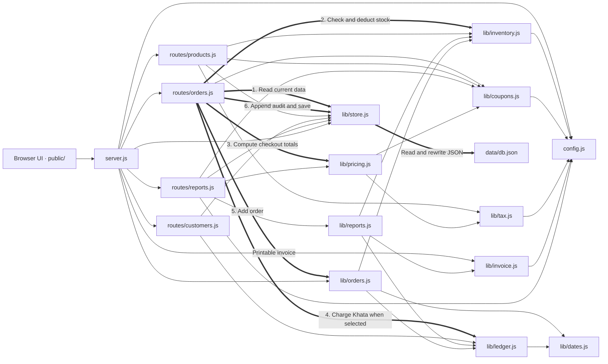

# ShopLedger architecture

[Open the standalone diagram](architecture.svg) for a screenshot of the architecture.

## Place an order

The browser sends item IDs, quantities, and checkout details to `POST /api/orders`. The router reads the current store, resolves each item from the catalog, checks sellable stock, and validates the coupon. Pricing applies the discount and calculates GST using each item's HSN code. The stock check happens before pricing, and the physical stock deduction happens after any Khata debit succeeds.

The router then adds the order, appends an audit entry, and writes the updated database. On HTTP `201`, the browser displays the saved total and a link to the printable invoice. The invoice route retrieves the saved order and passes it to `lib/invoice.js` to calculate and render the printed figures. GST reconciliation uses that same invoice calculator to compare against the stored checkout figures.
